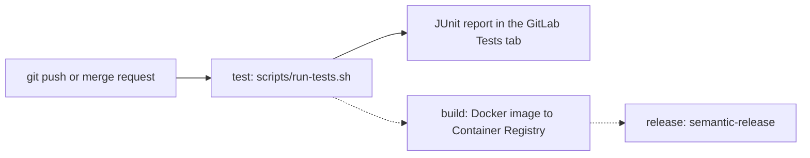

# Olympic Participation Tracker

[](https://gitlab.com/web-device-34-bouchet/olympic-participation-tracker/-/pipelines?ref=main)

## Context

The **Olympic Participation Tracker** is an application designed to record and analyze countries' participation in the Olympic Games. It provides statistics on medals obtained by each country, helping users gain insights into historical performance. Although the application is currently in its early development stages, we aim to create a robust and user-friendly tool for Olympic enthusiasts.

## Technical Context

The application is built using **Angular 20.3** and relies on **npm** for package management. Angular offers a powerful framework for creating dynamic web applications, and npm simplifies the process of managing dependencies and scripts.

Summary:

- **NodeJS**: Tested with version 24 (LTS)
- **NPM**: Tested with version 11
- **NGINX**: Tested with version 1.30

## Getting Started

### Install dependencies

Run `npm i` in local development to install NodeJS dependencies. If you are installing the app on a CI environment prefer to use `npm ci`. you can also change npm cache directory to your working directory as following

```bash
npm ci --cache .npm --prefer-offline
```

## Development server

Run `ng serve` for a dev server. Navigate to `http://localhost:4200/`. The application will automatically reload if you change any of the source files.

### Build

Run `npm run build` to build the project. The build artifacts will be stored in the `dist/` directory.

### Test

To run tests and ensure the application's functionality, use the following command:

```bash
npm test
```

Our test suite covers critical components, ensuring stability and reliability.

In CI, tests run through `./scripts/run-tests.sh`, which copies the JUnit
report to `test-results/` (see [CI/CD pipeline](#cicd-pipeline-gitlab)).

### Packaging

To package the application for distribution, run:

```bash
npm pack
```

This will create a distributable package containing the compiled code and necessary assets.

### Deploy on nginx

To deploy application on nginx web server with docker you can use nginx config located in the `nginx` folder. This one configure the root application folder in the `/app` folder.

After building the app copy the content of `dist/olympic-games-starter/browser`
(Angular 17+ output folder) to the root application folder in the docker image.

### Running with Docker Compose

The multi-stage `Dockerfile` builds the app with Node 24, then serves only the
compiled files with Nginx 1.30 as a non-root user.

```bash
docker compose up -d
```

The application is then available on http://localhost.

### Publishing to GitLab Registry

To publish the application to a GitLab registry, follow these steps:

1. **Change Application Scope**:
   - Change the application scope for your new gitlab group. For example, if your repository url is `https://gitlab.com/your-gitlab-group-slug/olympic-games-starter` change the application name to `@your-gitlab-group-slug/olympic-games-starter`
   ```json
   {
      "name": "@your-gitlab-group-slug/olympic-games-starter",
      ...
   }
   ```
2. To publish, you need to create a file named `.npmrc` with the following content :

   ```ini
   @your-gitlab-group-slug:registry=https://gitlab.com/api/v4/projects/${GITLAB_PROJECT_ID}/packages/npm/
   //gitlab.com/api/v4/projects/${GITLAB_PROJECT_ID}/packages/npm/:_authToken="${GITLAB_TOKEN}"
   ```

3. **Set Environment Variables**:
   - Ensure that the following environment variables are specified:
     - `GITLAB_PROJECT_ID`: The ID of your GitLab project.
     - `GITLAB_TOKEN`: Your GitLab deploy token.
4. **Execute the Publish Command**:
   ```bash
   npm publish
   ```
   This will publish the package to your GitLab registry.

## CI/CD pipeline (GitLab)

The same `.gitlab-ci.yml` is used in both repositories (Workshop Organizer
API and Olympic Participation Tracker). Each job only runs when the files of
its project type exist (`rules: exists`), so the pipeline adapts itself.



Dotted steps are planned and will be added next.

- **Triggers**: every branch push and every merge request (no duplicate
  pipeline when a merge request is open).
- **Test report**: `test-results/*.xml` is published as a JUnit report and
  kept even when tests fail (`artifacts: when: always`).
- **Cache**: dependencies are cached between pipelines. Measured on the API:
  Gradle tests went from 59 s to 17 s, and the whole pipeline from 1 min 32
  to 51 s.

### Configuration differences between the two projects

| | Workshop Organizer API | Olympic Participation Tracker |
|---|---|---|
| Test job | `test:spring-boot` | `test:angular` |
| Runs when | `gradlew` exists | `angular.json` exists |
| CI image | `eclipse-temurin:21-jdk` | `node:24-bookworm-slim` + Chromium |
| Test command (inside `run-tests.sh`) | `./gradlew clean test` | `npm test` (Karma, headless Chrome) |
| Raw JUnit reports | `build/test-results/test/` | `reports/` |
| Cache | `.gradle/` (key: `build.gradle` + Gradle wrapper version) | `.npm/` (key: `package-lock.json`) |

Run the same tests locally with `./scripts/run-tests.sh` (exit code 0 = OK,
1+ = failing tests, 2 = unknown project, 3 = missing tool, 4 = no report).
