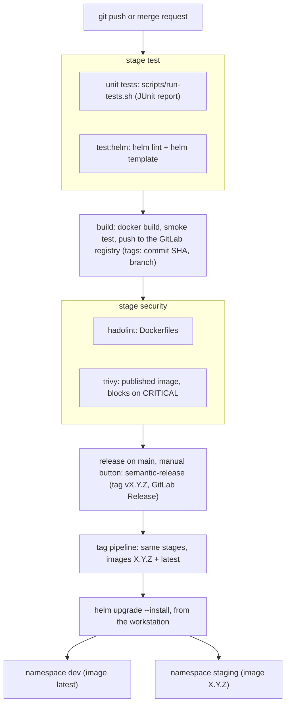

# Olympic Participation Tracker

[](https://gitlab.com/web-device-34-bouchet/olympic-participation-tracker/-/pipelines?ref=main)

## Context

The **Olympic Participation Tracker** is an application designed to record and analyze countries' participation in the Olympic Games. It provides statistics on medals obtained by each country, helping users gain insights into historical performance. Although the application is currently in its early development stages, we aim to create a robust and user-friendly tool for Olympic enthusiasts.

## Technical Context

The application is built using **Angular 20.3** and relies on **npm** for package management. Angular offers a powerful framework for creating dynamic web applications, and npm simplifies the process of managing dependencies and scripts.

Summary:

- **NodeJS**: Tested with version 24 (LTS)
- **NPM**: Tested with version 11
- **NGINX**: Tested with version 1.30

## Getting Started

### Install dependencies

Run `npm i` in local development to install NodeJS dependencies. If you are installing the app on a CI environment prefer to use `npm ci`. you can also change npm cache directory to your working directory as following

```bash
npm ci --cache .npm --prefer-offline
```

## Development server

Run `ng serve` for a dev server. Navigate to `http://localhost:4200/`. The application will automatically reload if you change any of the source files.

### Build

Run `npm run build` to build the project. The build artifacts will be stored in the `dist/` directory.

### Test

To run tests and ensure the application's functionality, use the following command:

```bash
npm test
```

Our test suite covers critical components, ensuring stability and reliability.

In CI, tests run through `./scripts/run-tests.sh`, which copies the JUnit
report to `test-results/` (see [CI/CD pipeline](#cicd-pipeline-gitlab)).

### Packaging

To package the application for distribution, run:

```bash
npm pack
```

This will create a distributable package containing the compiled code and necessary assets.

### Deploy on nginx

To deploy application on nginx web server with docker you can use nginx config located in the `nginx` folder. This one configure the root application folder in the `/app` folder.

After building the app copy the content of `dist/olympic-games-starter/browser`
(Angular 17+ output folder) to the root application folder in the docker image.

### Running with Docker Compose

The multi-stage `Dockerfile` builds the app with Node 24, then serves only the
compiled files with Nginx 1.30 as a non-root user.

```bash
docker compose up -d
```

The application is then available on http://localhost.

### Publishing to GitLab Registry

To publish the application to a GitLab registry, follow these steps:

1. **Change Application Scope**:
   - Change the application scope for your new gitlab group. For example, if your repository url is `https://gitlab.com/your-gitlab-group-slug/olympic-games-starter` change the application name to `@your-gitlab-group-slug/olympic-games-starter`
   ```json
   {
      "name": "@your-gitlab-group-slug/olympic-games-starter",
      ...
   }
   ```
2. To publish, you need to create a file named `.npmrc` with the following content :

   ```ini
   @your-gitlab-group-slug:registry=https://gitlab.com/api/v4/projects/${GITLAB_PROJECT_ID}/packages/npm/
   //gitlab.com/api/v4/projects/${GITLAB_PROJECT_ID}/packages/npm/:_authToken="${GITLAB_TOKEN}"
   ```

3. **Set Environment Variables**:
   - Ensure that the following environment variables are specified:
     - `GITLAB_PROJECT_ID`: The ID of your GitLab project.
     - `GITLAB_TOKEN`: Your GitLab deploy token.
4. **Execute the Publish Command**:
   ```bash
   npm publish
   ```
   This will publish the package to your GitLab registry.

## CI/CD pipeline (GitLab)

The same `.gitlab-ci.yml` is used in both repositories (Workshop Organizer
API and Olympic Participation Tracker). Each job only runs when the files of
its project type exist (`rules: exists`), so the pipeline adapts itself.



On merge request pipelines, only the checks run (tests, `test:helm`,
hadolint): images are built, scanned and published once per commit, on the
branch or tag pipeline.

- **Triggers**: every branch push, every merge request (no duplicate
  pipeline when a merge request is open) and every version tag `vX.Y.Z`.
  The release commit `chore(release): X.Y.Z` does not start a branch
  pipeline: its tag already starts one.
- **Test report**: `test-results/*.xml` is published as a JUnit report and
  kept even when tests fail (`artifacts: when: always`).
- **Cache**: dependencies are cached between pipelines. Measured on the API:
  Gradle tests went from 59 s to 17 s, and the whole pipeline from 1 min 32
  to 51 s.
- **Build** (branch and tag pipelines, after all tests passed): the image is
  built with Docker-in-Docker, started once by `scripts/smoke-test.sh`, and
  pushed only if it answers. Each image gets two tags: one that never changes
  and one that moves.

  | Pipeline | Fixed tag | Moving tag |
  |---|---|---|
  | branch (e.g. `main`) | short commit SHA (`:3a979237`) | branch name (`:main`) |
  | version tag (e.g. `v1.2.3`) | semantic version (`:1.2.3`) | `:latest` |

- **Helm chart check** (`test:helm`, every pipeline): `helm lint` with the
  default, dev and staging values, then `helm template` renders all the
  Kubernetes manifests. No cluster is needed: a broken chart is caught before
  any deployment.
- **Security** (stage `security`, see [Security](#security) for the results):

  | Job | Tool | Checks | Fails the pipeline when |
  |---|---|---|---|
  | `security:hadolint` | hadolint 2.14.0 | Dockerfile good practices (starts at once, `needs: []`) | any finding |
  | `security:trivy` | trivy 0.75.0 | the image just published: system packages and application libraries | a **CRITICAL** vulnerability remains |

  HIGH vulnerabilities are listed in the job log and in the report
  `trivy-security-trivy.txt` (job artifact, kept one week) but do not block.
  A CRITICAL vulnerability that cannot be fixed yet can be accepted in a
  `.trivyignore` file at the root of the repository, one CVE per line, with a
  reason and an expiry date (`CVE-XXXX-YYYY exp:2026-12-31`): after that date
  the pipeline fails again.
- **Nightly scan**: a pipeline schedule (Build → Pipeline schedules) runs on
  `main` every night. It runs the tests and checks but **does not build**:
  trivy scans the image `:latest` (the last released version) with that
  day's vulnerability database, so a new CRITICAL CVE fails the pipeline
  even when the code has not changed, and published tags stay immutable.
- **Secrets**: the registry password is a temporary job token provided by
  GitLab, sent with `--password-stdin` (never printed) and removed at the end
  of the job (`docker logout` in `after_script`); trivy reads the image with
  the same temporary token. The release job uses the `GITLAB_TOKEN` variable
  (see below).

### Releases (semantic-release)

A release is started **by hand** on `main`, when the team decides to publish:
the `release` job waits for a click (`when: manual`). It reads
`.releaserc.yml` and does everything else automatically:

1. reads the commits since the last tag (Conventional Commits) and computes
   the next version (Semantic Versioning):

   | Commit type | Example | New version |
   |---|---|---|
   | `fix:` | `fix(deps): update Spring Boot` | patch: 0.2.4 → 0.2.5 |
   | `feat:` | `feat(api): add a filter` | minor: 0.2.5 → 0.3.0 |
   | `!` or `BREAKING CHANGE:` | `feat(api)!: rename an endpoint` | major: 0.3.0 → 1.0.0 |
   | `docs`, `ci`, `build`, `chore`, `style`, `test` | `docs(readme): …` | no release |

2. writes the release notes at the top of `CHANGELOG.md`;
3. writes the version in the project files with `scripts/release.py`
   (`package.json` + `package-lock.json`, or `build.gradle`);
4. commits these files (`chore(release): X.Y.Z`), creates the tag `vX.Y.Z`
   and pushes both;
5. creates the **GitLab Release** (Deploy → Releases) with the notes;
6. the tag starts a new pipeline, which publishes the images `:X.Y.Z` and
   `:latest`.

**Start a release**

- Web: Build → Pipelines → last `main` pipeline → `release` → Run (▶).
- Terminal ([glab](https://gitlab.com/gitlab-org/cli)):
  `glab ci trigger release --branch main`.

If no `feat` or `fix` commit was merged since the last tag, the job ends
green with "There are no relevant changes": nothing is published.

**`scripts/release.py`** (Python 3, standard library only)

| Item | Details |
|---|---|
| Purpose | writes the new version in the project files before the release commit (`package.json` + lock or `build.gradle`, and `appVersion` of `charts/*/Chart.yaml`) |
| Called by | `@semantic-release/exec` (`prepareCmd` in `.releaserc.yml`) |
| Usage | `python3 scripts/release.py <version>` (e.g. `0.2.5`) |
| Detection | same rule as `run-tests.sh`: `gradlew` + `build.gradle` → Spring Boot, `package.json` + `angular.json` → Angular |
| Exit codes | 0 = version written, 1 = wrong usage, 2 = unknown project type, 3 = invalid version or file |

**`GITLAB_TOKEN`** (group CI/CD variable, masked and protected)

The release job must push a commit and a tag, which the default CI job token
cannot do. It uses a **fine-grained personal access token**, limited to the
`web-device-34-bouchet` group, with an expiry date and only these
permissions:

| Resource | Permissions | Used for |
|---|---|---|
| Code | Download, Read, Push | fetch the history, push the release commit and tag |
| Release | Create | create the GitLab Release |
| Project | Read | read the project information |

"Protected" means the variable is only given to pipelines of protected
branches (`main`): a job on a feature branch cannot read it. Comments on
merge requests and issues are disabled in `.releaserc.yml`
(`successCommentCondition: false`, `failCommentCondition: false`), so the
token needs no merge request permission.

Versions pinned in the job: semantic-release 25.0.9,
`conventional-changelog-conventionalcommits` 9.3.1 (10.x is not compatible
with semantic-release 25), plugins `changelog`, `exec`, `git`, `gitlab`.

### Configuration differences between the two projects

| | Workshop Organizer API | Olympic Participation Tracker |
|---|---|---|
| Test job | `test:spring-boot` | `test:angular` |
| Runs when | `gradlew` exists | `angular.json` exists |
| CI image | `eclipse-temurin:21-jdk` | `node:24-bookworm-slim` + Chromium |
| Test command (inside `run-tests.sh`) | `./gradlew clean test` | `npm test` (Karma, headless Chrome) |
| Raw JUnit reports | `build/test-results/test/` | `reports/` |
| Cache | `.gradle/` (key: `build.gradle` + Gradle wrapper version) | `.npm/` (key: `package-lock.json`) |
| Helm chart check | `test:helm` on `charts/workshop-api-chart` | `test:helm` on `charts/olympic-tracker-chart` |
| Build job | `build:image` + `build:db-image` (PostgreSQL) | `build:image` (shared) |
| Security jobs | `security:hadolint` (2 Dockerfiles), `security:trivy` + `security:trivy-db` | `security:hadolint`, `security:trivy` |
| Accepted vulnerabilities | `.trivyignore`: 2 Spring CVEs until 2026-12-31 | none |
| Docker image | multi-stage: JDK 21 + Gradle, then JRE 21 (WAR) | multi-stage: Node 24, then Nginx 1.30 |
| Smoke test (inside `smoke-test.sh`) | API + temporary PostgreSQL, `GET /api/notions` | Nginx, `GET /` |
| Version file (synced by `release.py`) | `build.gradle` (`version = '…'`) | `package.json` + `package-lock.json` |
| First version released | 0.2.5 (starting tag `v0.2.4`) | 0.1.4 (starting tag `v0.1.3`) |
| Registry image | `registry.gitlab.com/web-device-34-bouchet/workshop-organizer-api` | `registry.gitlab.com/web-device-34-bouchet/olympic-participation-tracker` |
| Compressed image size | 122.6 MB | 28.6 MB |

### Differences between local and CI environments

| | Local machine | GitLab CI |
|---|---|---|
| Tools | Java / Node installed on the machine | official images (`eclipse-temurin`, `node`, `docker`) |
| Browser for Angular tests | found automatically by `run-tests.sh` | Chromium installed by the job, `CHROME_BIN` set |
| Dependency cache | `~/.gradle`, `~/.npm` | `.gradle/` and `.npm/` inside the project (GitLab only caches project paths) |
| Docker | the machine's Docker daemon | Docker-in-Docker service (`docker:29-dind`) |
| Smoke test ports | none published (no conflict with apps already running, e.g. on 8080) | same script, same behaviour |
| Database credentials (API) | `.env` file, never committed (see `.env.example`) | random password generated for each smoke test |
| Registry login | not needed | temporary job token, logged out at the end of the job |

Run the same checks locally:

- `./scripts/run-tests.sh` (exit code 0 = OK, 1+ = failing tests,
  2 = unknown project, 3 = missing tool, 4 = no report);
- `docker build -t my-image . && ./scripts/smoke-test.sh my-image`
  (exit code 0 = the image answers, 1 = it does not, 2 = unknown project);
- `python3 scripts/release.py 9.9.9` on a copy of the project, to see which
  file would be updated (do not commit it: versions are written by the
  release job only);
- the CI security and chart checks, with the same pinned images:

  ```bash
  docker run --rm -i hadolint/hadolint:v2.14.0-alpine hadolint - < Dockerfile
  docker run --rm -v /var/run/docker.sock:/var/run/docker.sock \
    aquasec/trivy:0.75.0 image --severity HIGH,CRITICAL my-image
  helm lint charts/olympic-tracker-chart \
    -f charts/olympic-tracker-chart/values-staging.yaml
  ```

## Deployment on Kubernetes (Minikube + Helm)

The application runs on a local Kubernetes cluster (Minikube) in two
environments, `dev` and `staging`, each in its own namespace.

### Prerequisites

| Tool | Version used | Check |
|---|---|---|
| Minikube (Docker driver) | 1.39 (Kubernetes 1.37) | `minikube status` |
| kubectl | 1.37 | `kubectl version --client` |
| Helm | 4.3 | `helm version` |

```bash
minikube start --driver=docker --cpus=4 --memory=6g   # after a reboot: minikube start
kubectl create namespace dev
kubectl create namespace staging
```

The images live in the **private** GitLab Container Registry. Each namespace
gets its own read-only access: one GitLab **deploy token** per environment
(scope `read_registry` only), stored as a `docker-registry` Secret named
`gitlab-registry`. The token is typed without being displayed and is never
committed:

```bash
read -rp "Deploy token username: " DT_USER
read -rsp "Deploy token: " DT_PASS; echo
kubectl -n dev create secret docker-registry gitlab-registry \
  --docker-server=registry.gitlab.com \
  --docker-username="$DT_USER" --docker-password="$DT_PASS"
unset DT_USER DT_PASS
# same for staging, with its own deploy token
```

### Raw manifests (`k8s/`)

The `k8s/` folder holds the plain Kubernetes manifests (first deployment,
kept as reference). The Helm chart below is built from them.

| File | Resource |
|---|---|
| `k8s/deployment-app.yaml` | Deployment: 1 Nginx Pod, non-root (`runAsNonRoot`, uid 101), image pulled with `gitlab-registry` |
| `k8s/service-app.yaml` | Service `olympic-games-app-service`, port 80 |

### Helm chart (`charts/olympic-tracker-chart`)

```
charts/olympic-tracker-chart/
├── Chart.yaml            chart version + appVersion (synced by release.py)
├── values.yaml           default values
├── values-dev.yaml       dev overrides
├── values-staging.yaml   staging overrides
└── templates/            deployment.yaml, service.yaml, NOTES.txt
```

Values that can change per environment: `app.replicaCount`,
`app.image.repository`, `app.image.tag`, `app.port`, `app.imagePullSecret`,
`app.resources`.

### Environments

| Setting | dev | staging |
|---|---|---|
| Namespace | `dev` | `staging` |
| Replicas | 1 | 2 |
| Image tag | `latest` (last release) | `0.2.0` (fixed semantic version) |
| CPU request / limit | 50m / 200m | 100m / 300m |
| Memory request / limit | 32Mi / 64Mi | 48Mi / 96Mi |
| Registry access | deploy token `minikube-pull-dev` | deploy token `minikube-pull-staging` |

```bash
helm lint charts/olympic-tracker-chart
helm install olympic-games-app charts/olympic-tracker-chart -n dev \
  -f charts/olympic-tracker-chart/values-dev.yaml --wait
helm install olympic-games-app charts/olympic-tracker-chart -n staging \
  -f charts/olympic-tracker-chart/values-staging.yaml --wait
kubectl -n dev port-forward svc/olympic-games-app-service 8081:80
# then open http://localhost:8081
```

Update, roll back or remove a release:

```bash
helm upgrade olympic-games-app charts/olympic-tracker-chart -n staging \
  -f charts/olympic-tracker-chart/values-staging.yaml --wait
helm history olympic-games-app -n staging
helm rollback olympic-games-app <revision> -n staging
helm uninstall olympic-games-app -n staging
```

### Kubernetes security

- Containers refuse to start as root (`runAsNonRoot`) and cannot gain
  privileges (`allowPrivilegeEscalation: false`); images use numeric users.
- No credential is committed: registry tokens and database passwords are
  created in the cluster, one per environment.

## Security

Dependencies are checked with **npm audit**, the Docker image with **trivy**
(HIGH and CRITICAL vulnerabilities) and the Dockerfile with **hadolint**.

- **Dependency update (October 2026)**: Angular 20.3.7 → 20.3.34 with
  `ng update` (same major version), then `npm audit fix` without `--force`.
  Result: npm audit **60 → 6** vulnerabilities, **0 critical**; tests, build
  and smoke test unchanged.
- **Second update (2026-10-25, issue #1)**: `npm audit` reported 4 HIGH and
  1 LOW in the development toolchain (`@angular/cli`, `vite`, `body-parser`,
  `@modelcontextprotocol/sdk`). `npm audit fix` without `--force` updated 11
  packages in `package-lock.json` (Angular CLI 20.3.40 → 20.3.41, same major
  version). Result: npm audit **0 vulnerabilities**; tests, build and smoke
  test unchanged. These tools are never shipped in the Docker image (Nginx
  only serves the compiled files).
- **Container**: Nginx 1.30 runs as a non-root user. Every pipeline scans
  the published image with trivy (see [CI/CD pipeline](#cicd-pipeline-gitlab)).
  On 2026-10-24 it reported 1 HIGH vulnerability in a system library of the
  official image (`brotli-libs`, CVE-2026-111497) whose fix was not yet in
  the official image. The final stage of the Dockerfile now runs
  `apk upgrade --no-cache`, which applies the Alpine security fixes at build
  time (same Alpine release, fixes only). Result: **0 HIGH, 0 CRITICAL**,
  smoke test unchanged.

## Known limits and next steps

| Topic | Current state | Next step |
|---|---|---|
| Deployment | Helm releases are installed from the workstation on a local Minikube cluster; the CI cannot reach it | deployment job (`helm upgrade --install`) to a shared cluster, with an environment per namespace |
| Framework support | Angular 20 receives security fixes until 2026-11-28 (endoflife.date) | upgrade to Angular 22 (supported until 2028-06-30) |
| Unit test runner | Karma, deprecated by its maintainers (test tool only) | move the unit tests to another runner |
| Image reproducibility | `apk upgrade` at build time: two builds of the same commit can contain different (patched) system packages | accepted for security; images are traceable by their commit SHA tag |
| Dependency updates | detected by trivy and npm audit, updated by hand | Renovate bot opening update merge requests |
| Web server hardening | `nginx/nginx.conf` sets cache headers only, no security headers | security headers (Content-Security-Policy, frame protection, `nosniff`) in `nginx/nginx.conf` |
| Kubernetes health | no probe on the front: Kubernetes only checks that the Nginx process runs | readiness and liveness probes (`GET /`), NetworkPolicy (needs a CNI that enforces it) |
| Supply chain | images tagged and scanned | image signing (cosign) and SBOM |
